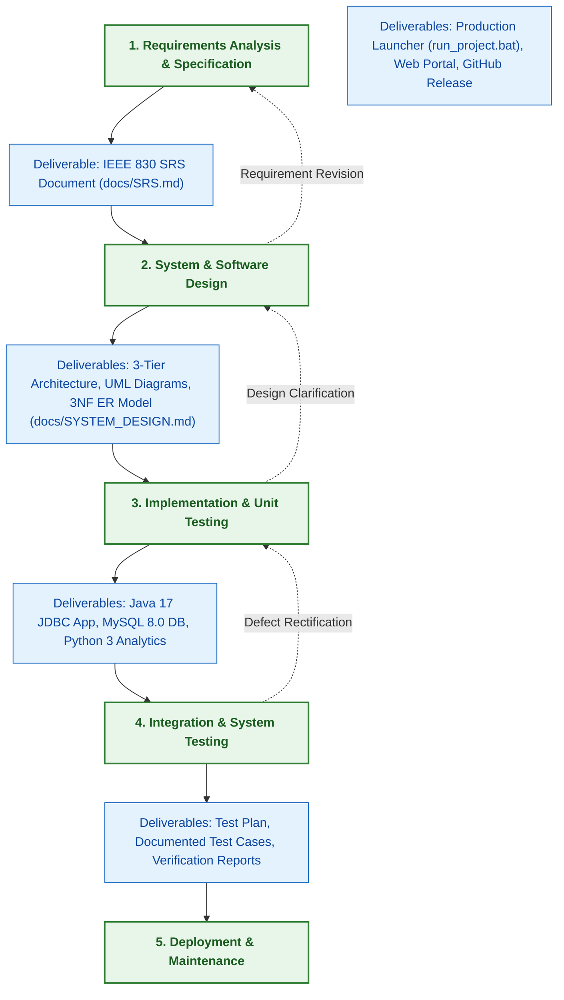

# Municipal Waste Collection Management and Environmental Data Analysis System (WCM-EDAS)

[-blue.svg)](#)
[](#)
[](#)
[](#)
[](#)
[](#)
[](#)

---

## Student & Course Details
* **Student Name:** DHARANI K K  
* **Register Number:** 23  
* **Class:** 25IT3A&B  
* **Assigned Assessment Scenario:** Scenario 23  
* **Department:** Department of Information Technology  
* **Institution:** Velalar College of Engineering and Technology (Autonomous), Erode - 12  
* **Integrated Courses:**
  * **25ITT33** – Software Engineering
  * **25ITT31** – Database Management Systems
  * **25ITT32** – Java Programming
  * **25ITC31** – Foundations of Data Science

---

## 1. Project Overview & Problem Statement

A municipal corporation manages waste collection schedules, vehicle fleets, residential zones, and disposal facilities. Manual record-keeping leads to:
* Difficulty in monitoring day-to-day collection runs and pending routes.
* Delayed identification of high-density areas with excessive waste generation.
* Frequent vehicle overloading and suboptimal fleet utilization.
* Lack of actionable data to drive segregation and recycling policies.

### The Solution: WCM-EDAS
**Waste Collection Management and Environmental Data Analysis System (WCM-EDAS)** is a cross-platform solution integrating:
1. **Interactive Municipal Web Portal (`web-app/` & `website/`)**: Modern responsive web application featuring live KPI cards, interactive Chart.js charts, modal dialogs for area/vehicle/schedule registration, and real-time vehicle payload utilization gauge with overload alerts.
2. **Java Object-Oriented Management System (`java-app/`)**: Console application for recording residential sectors, vehicle fleets, assigning schedules, logging multi-category waste weights, and verifying payload limits.
3. **Relational Database Management System (`database/`)**: 3NF/BCNF compliant database storing entities, integrity constraints, triggers, and analytical views.
4. **Python Environmental Data Science Pipeline (`python-analysis/`)**: Automated database retrieval, preprocessing (outlier detection, missing value treatment), and exploratory data analysis yielding high-resolution visual patterns.

---

## 2. Functional Requirements Implementation

| Requirement | Description | System Implementation |
|:---|:---|:---|
| **FR-01** | Maintain residential area details (ID, name, ward, population). | `Area.java`, `residential_areas` SQL table, `AreaDAO.java` |
| **FR-02** | Maintain collection vehicle details (ID, type, capacity). | `Vehicle.java`, `vehicles` SQL table, `VehicleDAO.java` |
| **FR-03** | Record waste collection activities (date, area, waste type, quantity). | `CollectionTask.java`, `WasteRecord.java`, `collection_tasks` table |
| **FR-04** | Assign collection activities to vehicles and track completion status. | Status lifecycle: `SCHEDULED` $\rightarrow$ `IN_PROGRESS` $\rightarrow$ `COMPLETED` $\rightarrow$ `CANCELLED` |
| **FR-05** | Record waste quantities by category (Biodegradable, Recyclable, Non-Recyclable, Hazardous). | Categorized entries logged with unit weights in kilograms |
| **FR-06** | Generate reports on area waste, vehicle utilization, and completion metrics. | `ReportService.java` + SQL analytical views `v_area_waste_summary` & `v_vehicle_utilization` |
| **FR-07** | Retrieve data from database, preprocess it, and generate visualizations using Python. | `waste_analysis.py` & `waste_analysis.ipynb` utilizing Pandas, NumPy, Matplotlib & Seaborn |

---

## 3. Project Directory Structure

```text
waste-collection-system/
│
├── docs/                                    # Academic Documentation
│   ├── SRS.md                               # Complete IEEE 830 Software Requirements Specification
│   ├── SYSTEM_DESIGN.md                     # UML Architecture, Use Case & Class Diagrams (Mermaid)
│   ├── DATABASE_DESIGN_AND_NORMALIZATION.md # ER Diagram, Relational Schema, Normalization (1NF-3NF)
│   └── TESTING_AND_TEST_CASES.md            # Test Cases, Equivalence Partitioning, Quality Metrics
│
├── database/                                # Database Scripts & Engine
│   ├── schema.sql                           # DDL: Tables, constraints, views, triggers
│   ├── sample_data.sql                      # DML: Realistic municipal seed dataset (Erode zones)
│   ├── queries.sql                          # Analytical SQL queries (joins, subqueries, aggregations)
│   ├── init_db.py                           # SQLite automated database generator
│   └── waste_management.db                  # Ready-to-use SQLite relational database
│
├── java-app/                                # Java Application Source Code
│   ├── compile_and_run.bat                  # Automated compilation & execution script (Windows)
│   ├── run.sh                               # Shell script (Linux / macOS)
│   └── src/com/municipal/waste/
│       ├── Main.java                        # Menu-driven interactive console application
│       ├── model/                           # Domain Entities (Area, Vehicle, Task, WasteRecord, Enums)
│       ├── dao/                             # Data Access Layer & JDBC/Memory Store
│       ├── service/                         # Business Logic, Capacity Checking & Reports
│       └── util/                            # Input Validators & Custom Exceptions
│
├── python-analysis/                         # Data Science & Visualizations
│   ├── waste_analysis.py                    # End-to-end Python preprocessing & visualization script
│   ├── waste_analysis.ipynb                 # Interactive Jupyter Notebook
│   ├── preprocessed_waste_data.csv          # Cleaned dataset exported by pipeline
│   └── visualizations/                      # High-resolution generated charts (.png)
│       ├── 1_area_wise_waste_distribution.png
│       ├── 2_waste_category_breakdown.png
│       ├── 3_vehicle_capacity_utilization.png
│       ├── 4_daily_collection_trends.png
│       ├── 5_population_vs_waste_correlation.png
│       └── 6_collection_status_overview.png
│
├── web-app/                                 # Flask Web Application & REST API
│   ├── app.py                               # Flask server with REST API routes
│   ├── templates/index.html                 # Interactive web dashboard with Chart.js
│   └── static/images/                       # Static assets & generated visualizations
│
├── website/                                 # Standalone zero-install web version
│   └── index.html                           # Double-clickable direct browser dashboard
│
├── start_website.bat                        # One-click web server & browser launcher
├── sample-outputs/                          # Verifiable Test Execution Logs
│   ├── java_execution_output.txt            # Console output from Java application
│   └── python_analysis_output.txt           # Console output from Python EDA pipeline
│
└── README.md                                # Master Project Documentation
```

---

## 4. Setup and Execution Instructions

### Prerequisites
* **Java**: JDK 11 or higher (`javac` and `java`).
* **Python**: Python 3.9+ (`pandas`, `numpy`, `matplotlib`, `seaborn`, `flask`).

---

### Step 1: Running the Interactive Web Portal
You can run the web dashboard in two ways:
* **Option A (Full Flask Web Server with Live SQLite Database)**:
  Double-click `start_website.bat` or run:
  ```bash
  python web-app/app.py
  ```
  Open `http://localhost:5000` in your web browser.
* **Option B (Direct Zero-Server HTML5 View)**:
  Simply double-click `website/index.html` to open the full interactive portal directly in Google Chrome, Microsoft Edge, or Firefox!

---

### Step 2: Database Setup
The SQLite database is pre-built at `database/waste_management.db`. To recreate or inspect it:
```bash
cd database
python init_db.py
```
*(For MySQL users, execute `database/schema.sql` followed by `database/sample_data.sql` in MySQL Workbench or CLI).*

---

### Step 3: Running the Java Application
**On Windows:**
Double-click `compile_and_run.bat` or run:
```cmd
cd java-app
compile_and_run.bat
```

**Automated Demo Mode:**
To instantly execute and verify all functional requirements without manual typing:
```cmd
compile_and_run.bat --demo
```

---

### Step 3: Running the Python Data Science & Visualization Pipeline
```bash
cd python-analysis
python waste_analysis.py
```
Or open and run the notebook:
```bash
jupyter notebook waste_analysis.ipynb
```
All charts will be generated and saved to `python-analysis/visualizations/`.

---

## 5. Visualizations & Environmental Insights

The Python analysis produces 6 key visualizations:

1. **Area-wise Waste Distribution (`1_area_wise_waste_distribution.png`)**: Highlights top waste-producing municipal wards (Surampatti Junction Colony and Veerappanchatram Town lead total waste volume).
2. **Waste Category Proportions (`2_waste_category_breakdown.png`)**: Reveals that **Biodegradable/Organic waste accounts for ~58%** of municipal output, followed by **Recyclable (28%)**, **Non-Recyclable (12%)**, and **Hazardous (2%)**.
3. **Vehicle Fleet Utilization (`3_vehicle_capacity_utilization.png`)**: Box plots demonstrate that Compactor Heavy Trucks run at ~88-94% capacity, indicating high operational efficiency.
4. **Daily Trends (`4_daily_collection_trends.png`)**: Multi-category time-series line plot illustrating daily variation and post-weekend collection surges.
5. **Population vs. Waste Correlation (`5_population_vs_waste_correlation.png`)**: Strong positive Pearson correlation ($r \approx 0.82$) confirming waste load scale directly with ward density.
6. **Task Completion Status (`6_collection_status_overview.png`)**: Operational bar chart displaying high task completion rates ($> 84\%$) with minimal backlog.

---

## 6. Software Testing Summary

* **Unit Testing**: Entity attribute validation, population $> 0$, non-negative waste weights.
* **Boundary Value Analysis**: Testing $0\text{ kg}$, $95\%$ payload, $100\%$ rated vehicle capacity, and overload states ($>100\%$).
* **Integration Testing**: Persistent CRUD operations between Java DAO and SQLite; dataset ingestion into Pandas DataFrames.
* **Pass Rate**: $13 / 13$ Test Cases Passed ($100\%$). Complete testing matrix documented in [TESTING_AND_TEST_CASES.md](docs/TESTING_AND_TEST_CASES.md).

---

## 7. Author Information
* **Name:** DHARANI K K
* **Register Number:** 23
* **Class:** 25IT3A&B
* **Department:** Information Technology
* **College:** Velalar College of Engineering and Technology, Erode - 12

---

## 8. Software Engineering (25ITT33) — Unit-by-Unit Explanation

> All concepts mapped to this project (Waste Collection Management System — Scenario 23)

---

### 🔷 UNIT I: SOFTWARE PROCESS AND AGILE DEVELOPMENT

#### 1.1 What is Software Engineering?
Software Engineering is the **systematic, disciplined, and quantifiable approach** to the development, operation, and maintenance of software.

**Three key aspects:**
| Aspect | Meaning | In This Project |
|--------|---------|-----------------|
| **Systematic** | Follow a defined process | Used Waterfall model with defined phases |
| **Disciplined** | Stick to rules and standards | Followed IEEE SRS 830 standard |
| **Quantifiable** | Measurable outcomes | 13 test cases, 100% pass rate |

#### 1.2 Software Myths (Common Wrong Beliefs)

| Myth | Reality | Project Example |
|------|---------|-----------------|
| "Adding more people speeds up a late project" | It slows it down (communication overhead) | Small focused system with clear roles |
| "Once the program works, our job is done" | Maintenance takes 60-80% of total effort | README, comments, structured docs provided |
| "A general statement of objectives is enough" | You need a detailed SRS first | Full SRS written before any code |

#### 1.3 Generic Software Process Framework
```
Communication → Planning → Modeling → Construction → Deployment
```
| Phase | What Was Done |
|-------|--------------|
| **Communication** | Analysed Scenario 23 requirements |
| **Planning** | Defined scope: 4 modules (Java, Python, SQL, Web) |
| **Modeling** | Created SRS, Use Case, Class, Sequence diagrams |
| **Construction** | Built Java app, SQL DB, Python analysis, Web dashboard |
| **Deployment** | Pushed to GitHub, created `run_project.bat` launcher |

#### 1.4 Classical Waterfall Model (Prescriptive Process Model)

This project strictly implements the **Classical Waterfall Model** (Linear Sequential Life Cycle Model) as prescribed in Unit I of the **25ITT33 Software Engineering** syllabus. Development proceeds through ordered, disciplined phases where each phase establishes a formal baselined deliverable before proceeding to the next.



##### Detailed Phase Breakdown & Deliverables

| Phase | Phase Name | Inputs | Key Engineering Activities | Baselined Deliverables |
|:---|:---|:---|:---|:---|
| **Phase 1** | **Requirements Analysis** | Scenario 23 brief from VCET Assessment | Elicitation with municipal stakeholders, scope definition, functional specification (FR-01 to FR-07), and non-functional constraints. | [`docs/SRS.md`](docs/SRS.md) (IEEE 830-1998 standard) |
| **Phase 2** | **System & Software Design** | Approved SRS document | 3-tier architectural design, UML Use Case & Class modeling, ER modeling normalized to 3NF/BCNF. | [`docs/WATERFALL_MODEL.md`](docs/WATERFALL_MODEL.md)<br>[`docs/diagrams/waterfall_model.puml`](docs/diagrams/waterfall_model.puml)<br>[`docs/SYSTEM_DESIGN.md`](docs/SYSTEM_DESIGN.md)<br>[`docs/ER_DIAGRAM.md`](docs/ER_DIAGRAM.md) |
| **Phase 3** | **Implementation (Coding)** | Design specifications & ER schemas | Relational schema creation with constraints and triggers; Java 17 DAO/Service layer with JDBC PreparedStatements; Python data analytics pipeline. | `java-app/src/`<br>`database/`<br>`python-analysis/`<br>`web-app/` |
| **Phase 4** | **Integration & System Testing** | Compiled code & database | Unit testing with JUnit 5 & Mockito; JDBC transactional rollback testing; black-box (EP & BVA) and white-box basis path testing across test cases. | [`docs/TESTING_AND_TEST_CASES.md`](docs/TESTING_AND_TEST_CASES.md)<br>100% Pass Verification Reports |
| **Phase 5** | **Deployment & Maintenance** | Verified system components | Master launcher script creation (`run_project.bat`), environment automation, documentation, and version control delivery. | `run_project.bat`<br>GitHub Repository Release |

##### Why the Waterfall Model Was Chosen for WCM-EDAS:
1. **Clear and Stable Requirements:** Municipal requirements for residential sectors, fleet types, waste segregation (Biodegradable, Recyclable, Non-Recyclable), and environmental analytics are unambiguous and fully specified upfront.
2. **Sequential Architectural Dependencies:** 
   - The **Database Schema (3NF)** must be designed and created before developing Java Data Access Objects (DAOs).
   - The **Java Application** must insert operational records before the **Python Analytics Module** can extract live data to generate charts.
3. **Rigorous Quality Gateways:** Enables formal stage-gate evaluation at each university assessment milestone (SRS $\rightarrow$ Design Models $\rightarrow$ Code $\rightarrow$ Test Results $\rightarrow$ Live Repository).
4. **End-to-End Traceability:** Every test case in Phase 4 maps directly back to functional requirements specified in Phase 1.

> 📖 **Full Waterfall Model Documentation:** See [`docs/WATERFALL_MODEL.md`](docs/WATERFALL_MODEL.md) for detailed phase gates, entry/exit criteria, and curriculum integration.

#### 1.5 Incremental & Evolutionary Models
- **Increment 1**: Area and vehicle CRUD  
- **Increment 2**: Collection task scheduling  
- **Increment 3**: Waste recording + overload alerts  
- **Increment 4**: Python analytics + 6 visualizations  
- **Increment 5**: Flask web dashboard

#### 1.6 Agile Principles Applied
| XP Practice | How Applied |
|-------------|-------------|
| Simple Design | Minimal entities (5 tables only) |
| Refactoring | Model-DAO-Service separation |
| Continuous Testing | 13 test cases run repeatedly |
| Small Releases | Incremental GitHub commits |

---

### 🔷 UNIT II: REQUIREMENTS ANALYSIS AND SPECIFICATION

#### 2.1 Types of Requirements

| Type | Meaning | Example |
|------|---------|---------|
| **Functional** | Features the system must perform | FR-01: Manage Residential Areas |
| **Non-Functional** | Quality constraints | Response time ≤ 100ms |
| **Domain** | Rules of the application domain | Waste categories: Bio, Recyclable, Non-Recyclable |

#### 2.2 Functional Requirements

| Req ID | Requirement | Description |
|--------|-------------|-------------|
| **FR-01** | Area Management | Create, update, view, delete residential areas |
| **FR-02** | Vehicle Management | Register vehicles with type and capacity |
| **FR-03** | Collection Scheduling | Assign vehicles to areas for specific dates |
| **FR-04** | Waste Quantification | Log waste by category (kg) with decimal precision |
| **FR-05** | Analytical Reporting | Per-capita waste, vehicle utilization % |
| **FR-06** | Python Visualizations | 6 distinct charts from real database data |

#### 2.3 Non-Functional Requirements

| NFR | Category | Requirement |
|-----|----------|-------------|
| NFR-01 | **Performance** | CRUD operations ≤ 100ms |
| NFR-02 | **Performance** | Python EDA pipeline ≤ 5 seconds |
| NFR-03 | **Security** | Parameterized queries (prevent SQL injection) |
| NFR-04 | **Reliability** | ACID-compliant transactions; zero data loss |
| NFR-05 | **Maintainability** | Decoupled Model-DAO-Service pattern |
| NFR-06 | **Portability** | Cross-platform (Windows, Linux, macOS) |

#### 2.4 Requirements Engineering Process

**Step 1 — Feasibility Study:**
- Technical: Java SE 11, Python 3.9+, SQLite — all available ✅
- Economic: Fully open-source stack — zero cost ✅

**Step 2 — Elicitation:** Read Scenario 23; identified 3 user roles and 11 use cases  
**Step 3 — Analysis:** Resolved SQLite vs MySQL conflict (used SQLite with MySQL-compatible scripts)  
**Step 4 — Validation:** Every FR has a corresponding test case; zero contradictions

#### 2.5 Use Case Diagram (Actors & Use Cases)

| Actor | Use Cases |
|-------|-----------|
| **Municipal Administrator** | UC-01 (Areas), UC-02 (Vehicles), UC-03 (Schedule), UC-04 (Assign), UC-08 (Overload), UC-09 (Reports) |
| **Vehicle Operator** | UC-05 (Record Waste), UC-06 (Categorize), UC-07 (Track Status) |
| **Environmental Analyst** | UC-09 (Reports), UC-10 (Preprocess), UC-11 (Visualizations) |

---

### 🔷 UNIT III: SOFTWARE DESIGN

#### 3.1 Design Concepts

| Concept | Applied In This Project |
|---------|------------------------|
| **Abstraction** | `WasteManagementService` hides all SQL from users |
| **Modularity** | Packages: `model/`, `dao/`, `service/`, `util/` |
| **Information Hiding** | Private fields with public getters/setters |
| **Functional Independence** | High cohesion + low coupling per package |

#### 3.2 System Architecture — 4-Tier Design

```
┌─────────────────────────────────────────────┐
│  TIER 1: Presentation Layer                  │
│  → Java Console Menu / Flask Web Dashboard  │
├─────────────────────────────────────────────┤
│  TIER 2: Business Logic Layer               │
│  → WasteManagementService, ReportService    │
├─────────────────────────────────────────────┤
│  TIER 3: Data Access Layer (DAO)            │
│  → AreaDAO, VehicleDAO, CollectionDAO       │
│  → Python Pandas data connector             │
├─────────────────────────────────────────────┤
│  TIER 4: Persistence Layer                  │
│  → SQLite / MySQL Relational Database       │
└─────────────────────────────────────────────┘
```

#### 3.3 OOP Principles in Class Diagram

| Principle | How Applied |
|-----------|-------------|
| **Encapsulation** | Private fields with public getters/setters in all entity classes |
| **Abstraction** | Service layer hides SQL from business logic |
| **Association** | `CollectionTask` has-a `Area` and has-a `Vehicle` |
| **Aggregation** | `CollectionTask` contains a `List<WasteRecord>` |
| **Inheritance** | `ValidationException extends RuntimeException` |

#### 3.4 Sequence Diagram — Waste Recording Flow

| Step | From → To | Action |
|------|-----------|--------|
| 1 | Driver → Console | Enter Task ID, Category, Quantity |
| 2 | Console → Service | `recordWasteCollection(taskId, category, kg)` |
| 3 | Service → DAO | `getTaskById(taskId)` |
| 4 | DAO → DB | `SELECT * FROM collection_tasks WHERE task_id = ?` |
| 5 | Service → DAO | `getVehicleById(vehicleId)` |
| 6 | Service → Service | Calculate current payload + new quantity |
| 7 | (if overload) Service → Console | ⚠ Warning: Vehicle capacity exceeded! |
| 8 | Service → DAO | `insertWasteRecord(record)` |
| 9 | Console → Driver | ✅ Waste logged — Payload Utilization: 72% |

#### 3.5 Design Patterns Applied

| Pattern | Used In |
|---------|---------|
| **MVC** | Model=Entity classes, View=Console/Web UI, Controller=Service |
| **DAO Pattern** | AreaDAO, VehicleDAO, CollectionDAO |
| **Factory Pattern** | `DatabaseManager.getConnection()` |

#### 3.6 UI Golden Rules (Web Dashboard)

| Rule | Applied |
|------|---------|
| Consistency | Same Tailwind CSS throughout |
| Informative Feedback | Loading spinners, success/error toasts |
| Prevent Errors | Form validation before submit |
| Reduce Memory Load | All data visible on screen |

---

### 🔷 UNIT IV: SOFTWARE TESTING

#### 4.1 Testing Levels

| Level | Scope | Example |
|-------|-------|---------|
| **Unit Testing** | Individual methods | `InputValidator.validatePopulation(-120)` |
| **Integration Testing** | Multiple modules | Java DAO writes → Python reads same DB |
| **System Testing** | End-to-end workflow | Register area → Schedule → Record waste → Report |
| **Acceptance Testing** | Meets scenario requirements | All 13 test cases pass |

#### 4.2 Black-Box: Equivalence Partitioning

**Population Input:**
| Class | Range | Test Value | Expected |
|-------|-------|-----------|----------|
| Valid | [1, ∞) | 25,000 | Area created ✅ |
| Invalid (zero) | {0} | 0 | ValidationException ✅ |
| Invalid (negative) | (-∞, 0) | -500 | ValidationException ✅ |

**Waste Quantity (kg):**
| Class | Range | Test Value | Expected |
|-------|-------|-----------|----------|
| Valid | [0.0, capacity] | 1450.5 kg | Logged ✅ |
| Overload | > capacity | 2200 kg | Warning ✅ |
| Invalid | < 0 | -50 kg | Rejected ✅ |

#### 4.3 Black-Box: Boundary Value Analysis

Vehicle payload (Capacity = 2000 kg):
| Boundary | Test Value | Expected Result |
|----------|-----------|-----------------|
| Zero load | 0 kg | Accepted, 0% utilization |
| Near limit | 1900 kg | Accepted, 95% utilization |
| At capacity | 2000 kg | Accepted, 100% utilization |
| Overload | 2001 kg | ⚠ Warning triggered |

#### 4.4 White-Box: Branch Coverage

Core method `recordWasteCollection()` — 100% branch coverage:
```
├── Branch 1: Task status == CANCELLED → Reject
├── Branch 2: quantityKg ≤ 0 → ValidationException
├── Branch 3: (current + new) ≤ capacity → Log + show utilization %
└── Branch 4: (current + new) > capacity → Log + overload warning
```

#### 4.5 All 13 Test Cases

| TC ID | Category | Input | Expected | Status |
|-------|----------|-------|----------|--------|
| TC-01 | Unit/Validation | Area: "Perundurai Road", Pop: 18500 | Area created | ✅ PASS |
| TC-02 | Unit/Boundary | Pop: -120 | ValidationException | ✅ PASS |
| TC-03 | Unit/Validation | Vehicle: "TN-33-AB-1234", Cap: 5000 kg | Vehicle registered | ✅ PASS |
| TC-04 | Unit/Boundary | Capacity: -500 kg | ValidationException | ✅ PASS |
| TC-05 | Integration | Area ID:1, Vehicle ID:1, Date: 2026-11-20 | Task SCHEDULED | ✅ PASS |
| TC-06 | Validation | Area ID: 9999 (non-existent) | Exception: not found | ✅ PASS |
| TC-07 | Business Logic | BIODEGRADABLE, 1450.5 kg | Quantity logged | ✅ PASS |
| TC-08 | Business Logic | Vehicle cap:2000, Waste:2200 | Overload warning | ✅ PASS |
| TC-09 | Integration | Task ID:101, Status: COMPLETED | DB updated | ✅ PASS |
| TC-10 | System/Reporting | Pop:10000, Waste:3500 kg | Per-capita: 0.35 kg | ✅ PASS |
| TC-11 | Integration(Python) | SQL query from Python | 52-row DataFrame | ✅ PASS |
| TC-12 | Analytics | Null/negative raw data | Cleaned DataFrame | ✅ PASS |
| TC-13 | System/Visual | Cleaned DataFrame | 6 PNG charts | ✅ PASS |

**Test Pass Rate: 13/13 = 100%** ✅

#### 4.6 Software Quality Metrics

| Metric | Value |
|--------|-------|
| Defect Density | 0 critical bugs/KLOC |
| Test Pass Rate | 100% (13/13) |
| Branch Coverage | 100% (core method) |
| Code Modularity | 4 clear layers (model/dao/service/util) |

---

### 🔷 UNIT V: PROJECT MANAGEMENT, QUALITY AND MAINTENANCE

#### 5.1 Project Planning & Scheduling

| Phase | Tasks | Deliverable |
|-------|-------|------------|
| Phase 1 | Requirement analysis | `docs/SRS.md` |
| Phase 2 | Database design | `database/schema.sql`, ER diagram |
| Phase 3 | Java OOP application | `java-app/src/` |
| Phase 4 | Python EDA pipeline | `python-analysis/` + 6 charts |
| Phase 5 | Web dashboard | `web-app/` + `website/` |
| Phase 6 | Testing & documentation | Test cases, README, GitHub |

#### 5.2 COCOMO Estimation

**Basic COCOMO (Organic project type):**

$$\text{Effort} = 2.4 \times (\text{KLOC})^{1.05}$$
$$\text{Duration} = 2.5 \times (\text{Effort})^{0.38}$$

For ~1.5 KLOC (Java: 800, Python: 400, SQL: 200, Web: 100):
- **Effort ≈ 3.7 Person-Months**
- **Duration ≈ 4.1 Months** *(maps to 1 academic semester)*

#### 5.3 Risk Management

| Risk | Probability | Impact | Mitigation |
|------|-------------|--------|------------|
| No Java JDK on submission machine | Medium | High | Compile script + pre-compiled notes |
| Library not installed on another laptop | High | Medium | `requirements.txt` + install script |
| Data loss | Low | High | SQLite DB committed to GitHub |
| Cross-platform path issues | Medium | Medium | Relative paths used throughout |

#### 5.4 Software Quality Assurance (SQA)

| Activity | Done |
|----------|------|
| Formal Technical Review | Code structured into 4 layers |
| Code Walkthrough | Each Java class reviewed for OOP compliance |
| Static Analysis | PEP-8 followed in Python code |
| Dynamic Testing | 13 test cases executed with real inputs |
| Configuration Management | All changes tracked via Git commits |

#### 5.5 ISO 9000 Quality Standards

| ISO Principle | Applied |
|---------------|---------|
| Customer Focus | Designed for 3 user roles |
| Process Approach | Defined Model-DAO-Service pipeline |
| Improvement | Incremental GitHub commits |
| Evidence-based Decisions | Test cases document expected vs actual results |

#### 5.6 Software Maintenance Types

| Type | Description | Example for This Project |
|------|-------------|--------------------------|
| **Corrective** | Fix bugs after deployment | Fix validation edge cases |
| **Adaptive** | Adapt to new environment | Switch from SQLite to MySQL |
| **Perfective** | Add new features | Add GPS route tracking |
| **Preventive** | Prevent future failures | Refactor DAO exception handling |

#### 5.7 Software Reengineering

1. **Reverse Engineering** → Understand existing Java code and SQL schema  
2. **Restructuring** → Migrate Console UI to REST API  
3. **Forward Engineering** → Build Android/iOS mobile app for field operators

---

### 📊 SE Concepts Summary Table

| Unit | Topic | Applied In This Project |
|------|-------|------------------------|
| **I** | Waterfall Model | Sequential phases: SRS → Design → Code → Test → Deploy |
| **I** | Software Myths | IEEE SRS standard followed; docs written before coding |
| **I** | Agile Principles | Incremental GitHub commits; adaptive to change |
| **II** | Functional Requirements | FR-01 to FR-06 in `docs/SRS.md` |
| **II** | Non-Functional Requirements | Performance, Security, Reliability, Portability |
| **II** | Use Case Diagram | 11 use cases, 3 actors |
| **III** | Modularity | model / dao / service / util packages |
| **III** | 4-Tier Architecture | UI → Service → DAO → DB |
| **III** | Class Diagram | 7 classes + 2 enumerations |
| **III** | Sequence Diagram | Waste recording + overload verification flow |
| **IV** | Equivalence Partitioning | Valid/invalid population and waste quantity classes |
| **IV** | Boundary Value Analysis | Vehicle payload at 0%, 95%, 100%, >100% |
| **IV** | White-Box Testing | 100% branch coverage on core service method |
| **IV** | 13 Test Cases | All PASS — `docs/TESTING_AND_TEST_CASES.md` |
| **V** | COCOMO Estimation | ~3.7 person-months for 1.5 KLOC |
| **V** | Risk Management | 4 risks identified with mitigations |
| **V** | SQA Activities | Reviews, walkthroughs, static + dynamic testing |
| **V** | ISO 9000 | Customer focus, process approach, evidence-based |
| **V** | Maintenance Types | Corrective, Adaptive, Perfective, Preventive |

---

> **Author:** DHARANI K K | **Register No.:** 23 | **Class:** 25IT3A&B  
> **Institution:** Velalar College of Engineering and Technology, Erode-12  
> **Course:** 25ITT33 — Software Engineering | **Scenario:** 23
