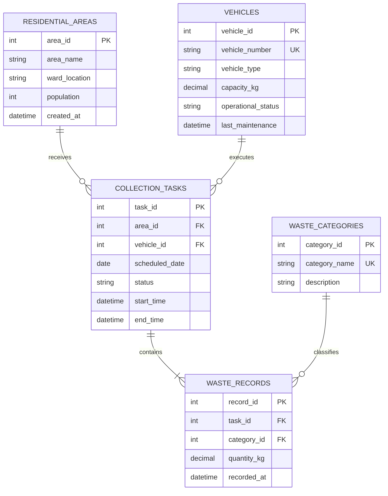

# Database Design and Normalization Document
## Waste Collection Management and Environmental Data Analysis System
**Author:** DHARANI K K (Register No.: 23)  
**Subject:** 25ITT31 - Database Management Systems  
**Class:** 25IT3A&B  

---

## 1. Entity-Relationship (ER) Diagram

---

## 2. Relational Schema Specification

1. **`residential_areas`**
   - **`area_id`** : `INT AUTO_INCREMENT PRIMARY KEY`
   - **`area_name`** : `VARCHAR(100) NOT NULL`
   - **`ward_location`** : `VARCHAR(100) NOT NULL`
   - **`population`** : `INT NOT NULL CHECK (population > 0)`
   - **`created_at`** : `TIMESTAMP DEFAULT CURRENT_TIMESTAMP`

2. **`vehicles`**
   - **`vehicle_id`** : `INT AUTO_INCREMENT PRIMARY KEY`
   - **`vehicle_number`** : `VARCHAR(20) NOT NULL UNIQUE`
   - **`vehicle_type`** : `VARCHAR(50) NOT NULL` (e.g., Compactor, Tipper, Mini-Truck, Electric-Cart)
   - **`capacity_kg`** : `DECIMAL(10,2) NOT NULL CHECK (capacity_kg > 0)`
   - **`operational_status`** : `VARCHAR(20) DEFAULT 'AVAILABLE'` (`AVAILABLE`, `ON_DUTY`, `MAINTENANCE`)
   - **`last_maintenance`** : `DATE`

3. **`waste_categories`**
   - **`category_id`** : `INT AUTO_INCREMENT PRIMARY KEY`
   - **`category_name`** : `VARCHAR(50) NOT NULL UNIQUE` (Biodegradable, Recyclable, Non-Recyclable, Hazardous)
   - **`description`** : `VARCHAR(255)`

4. **`collection_tasks`**
   - **`task_id`** : `INT AUTO_INCREMENT PRIMARY KEY`
   - **`area_id`** : `INT NOT NULL`, `FOREIGN KEY REFERENCES residential_areas(area_id) ON DELETE CASCADE`
   - **`vehicle_id`** : `INT NOT NULL`, `FOREIGN KEY REFERENCES vehicles(vehicle_id) ON DELETE CASCADE`
   - **`scheduled_date`** : `DATE NOT NULL`
   - **`status`** : `VARCHAR(20) DEFAULT 'SCHEDULED'` (`SCHEDULED`, `IN_PROGRESS`, `COMPLETED`, `CANCELLED`)
   - **`created_at`** : `TIMESTAMP DEFAULT CURRENT_TIMESTAMP`

5. **`waste_records`**
   - **`record_id`** : `INT AUTO_INCREMENT PRIMARY KEY`
   - **`task_id`** : `INT NOT NULL`, `FOREIGN KEY REFERENCES collection_tasks(task_id) ON DELETE CASCADE`
   - **`category_id`** : `INT NOT NULL`, `FOREIGN KEY REFERENCES waste_categories(category_id)`
   - **`quantity_kg`** : `DECIMAL(10,2) NOT NULL CHECK (quantity_kg >= 0)`
   - **`recorded_at`** : `TIMESTAMP DEFAULT CURRENT_TIMESTAMP`

---

## 3. Database Normalization Analysis

### 3.1 Unnormalized Form (UNF)
Consider a flat spreadsheet log used by municipal workers:
`Log(TaskID, AreaID, AreaName, Ward, Population, VehicleID, VehicleNum, VehicleType, Capacity, Date, Status, WasteCategory, QuantityKg)`

*Redundancy & Anomalies in UNF:*
- **Insertion Anomaly**: Cannot register a new vehicle or new residential area without scheduling a collection task.
- **Deletion Anomaly**: Deleting a historical collection task also deletes the existence of the area or vehicle.
- **Update Anomaly**: If an area's population changes, every historical row containing that area must be updated.

---

### 3.2 First Normal Form (1NF)
**Rule**: An entity is in 1NF if every attribute contains only atomic (indivisible) values, there are no repeating groups, and a unique primary key exists.

*Resolution*:
- Decompose repeating multi-category waste inputs into discrete records.
- Composite Candidate Key in combined table: `(TaskID, CategoryName)`.
- All attribute domains contain single scalar values.

---

### 3.3 Second Normal Form (2NF)
**Rule**: A table is in 2NF if it is in 1NF and no non-prime attribute is partially dependent on any candidate key (removal of Partial Dependencies).

*Functional Dependencies in Combined Data:*
- $FD_1: \text{TaskID} \rightarrow \text{AreaID}, \text{VehicleID}, \text{Date}, \text{Status}$
- $FD_2: \text{AreaID} \rightarrow \text{AreaName}, \text{Ward}, \text{Population}$
- $FD_3: \text{VehicleID} \rightarrow \text{VehicleNum}, \text{VehicleType}, \text{Capacity}$
- $FD_4: (\text{TaskID}, \text{CategoryID}) \rightarrow \text{QuantityKg}$

*Resolution*:
- Area attributes depended only on `AreaID` (part of no composite key).
- Vehicle attributes depended only on `VehicleID`.
- Decomposed into distinct relations: `residential_areas`, `vehicles`, `collection_tasks`, and `waste_records`.
- All partial dependencies are eliminated.

---

### 3.4 Third Normal Form (3NF)
**Rule**: A table is in 3NF if it is in 2NF and there is no transitive dependency (i.e., for every non-trivial dependency $X \rightarrow Y$, either $X$ is a superkey or $Y$ is a prime attribute).

*Resolution*:
- In `collection_tasks`: Primary Key is `task_id`.
  $$\text{task_id} \rightarrow \text{area_id}, \text{vehicle_id}, \text{scheduled_date}, \text{status}$$
  There are no transitive dependencies between non-key attributes (e.g., status does not determine date).
- In `residential_areas`: Primary Key is `area_id`.
  $$\text{area_id} \rightarrow \text{area_name}, \text{ward_location}, \text{population}$$
  No transitive dependencies exist.
- In `waste_records`: Primary Key is `record_id`.
  $$\text{record_id} \rightarrow \text{task_id}, \text{category_id}, \text{quantity_kg}$$
  Category description is segregated in `waste_categories` ($\text{category_id} \rightarrow \text{category_name}$), avoiding transitive dependency $\text{record_id} \rightarrow \text{category_id} \rightarrow \text{description}$.

Hence, all relations are in **3NF / BCNF (Boyce-Codd Normal Form)**.

---

## 4. Integrity Constraints & Views

### 4.1 Check Constraints
- `population > 0`
- `capacity_kg > 0`
- `quantity_kg >= 0`

### 4.2 Analytical View: `v_area_waste_summary`
Aggregates total waste collected, distinct collection runs, and per-capita metrics for each residential area.

### 4.3 Analytical View: `v_vehicle_utilization`
Calculates cumulative weight carried per vehicle trip against rated tonnage capacity to yield the payload utilization percentage.
