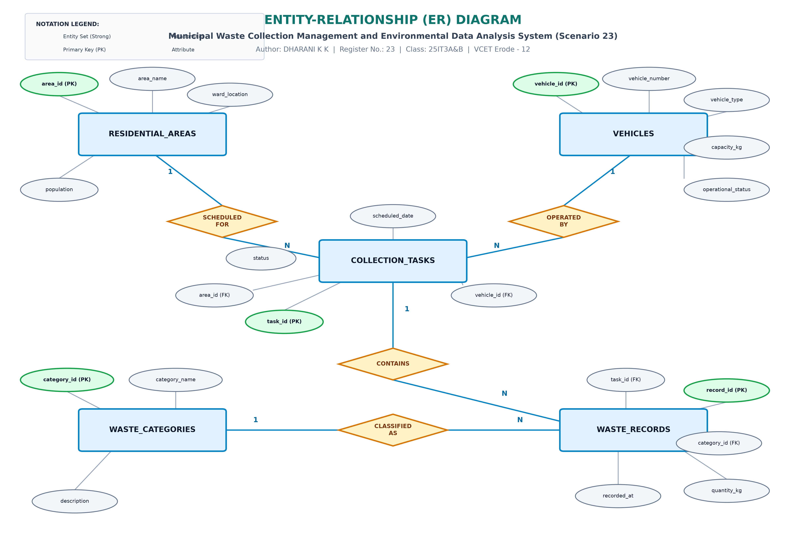
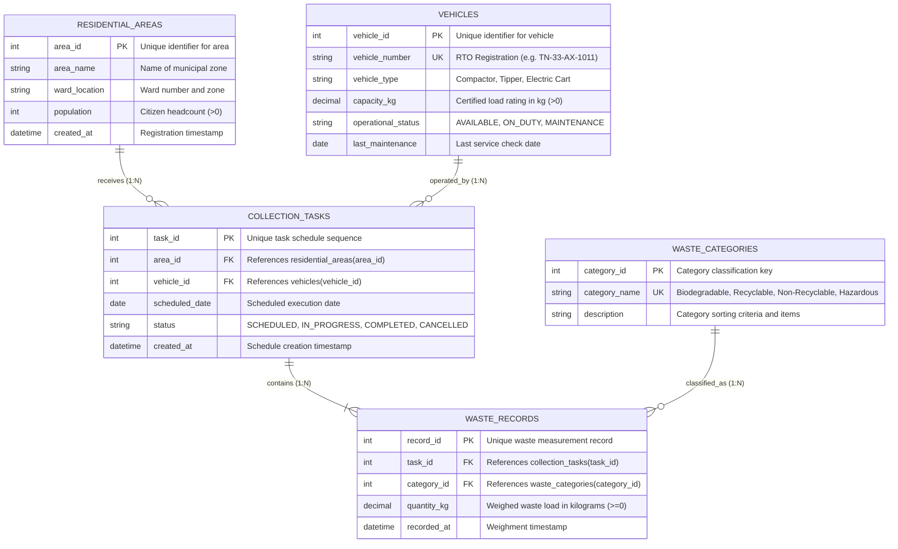

# Entity-Relationship (ER) Diagram Specification
## Municipal Waste Collection Management and Environmental Data Analysis System
**Author:** DHARANI K K  
**Register No.:** 23  
**Class:** 25IT3A&B  
**Institution:** Velalar College of Engineering and Technology, Erode - 12  
**Department:** Department of Information Technology  
**Subject Code & Title:** 25ITT31 - Database Management Systems  
**Assessment Scenario:** Scenario 23  

---

## 1. Visual ER Diagram

*(A high-resolution version is rendered above and also available at [`docs/er_diagram.png`](er_diagram.png) and within the Web Dashboard).*

---

## 2. Mermaid Crow's Foot ER Diagram

---

## 3. Structural Components of the ER Model

### 3.1 Entity Sets

1. **`RESIDENTIAL_AREAS` (Strong Entity)**:
   - Represents the physical residential neighborhoods and administrative wards under municipal coverage.
   - **Key Attribute**: `area_id` (Primary Key).
   - **Descriptive Attributes**: `area_name`, `ward_location`, `population`.

2. **`VEHICLES` (Strong Entity)**:
   - Represents the municipal sanitation fleet deployed for waste collection and transport.
   - **Key Attribute**: `vehicle_id` (Primary Key), `vehicle_number` (Candidate / Alternate Key - Unique).
   - **Descriptive Attributes**: `vehicle_type`, `capacity_kg`, `operational_status`, `last_maintenance`.

3. **`COLLECTION_TASKS` (Strong Entity)**:
   - Represents the operational assignment and scheduling of a specific vehicle to a residential zone for a specific date.
   - **Key Attribute**: `task_id` (Primary Key).
   - **Foreign Keys**: `area_id`, `vehicle_id`.
   - **Descriptive Attributes**: `scheduled_date`, `status`, `created_at`.

4. **`WASTE_CATEGORIES` (Strong Entity / Lookup Domain)**:
   - Represents standard waste classification streams per environmental solid waste management rules.
   - **Key Attribute**: `category_id` (Primary Key), `category_name` (Unique).
   - **Descriptive Attribute**: `description`.

5. **`WASTE_RECORDS` (Composite Entity / Weak Associative Entity)**:
   - Represents individual weighed loads of segregated waste collected during a specific task trip.
   - **Key Attribute**: `record_id` (Primary Key).
   - **Foreign Keys**: `task_id`, `category_id`.
   - **Descriptive Attributes**: `quantity_kg`, `recorded_at`.

---

## 4. Relationship Sets and Cardinality Constraints

| Relationship Name | Connecting Entities | Cardinality Ratio | Participation Constraint | Description |
|:---|:---|:---:|:---:|:---|
| **`SCHEDULED_FOR`** | `RESIDENTIAL_AREAS` $\rightarrow$ `COLLECTION_TASKS` | **1 : N** | Partial (Area) / Total (Task) | One residential area can have many collection tasks over time; every task must be assigned to exactly one area. |
| **`OPERATED_BY`** | `VEHICLES` $\rightarrow$ `COLLECTION_TASKS` | **1 : N** | Partial (Vehicle) / Total (Task) | One vehicle can execute multiple collection tasks across different dates; each task must be operated by one vehicle. |
| **`CONTAINS`** | `COLLECTION_TASKS` $\rightarrow$ `WASTE_RECORDS` | **1 : N** | Partial (Task) / Total (Record) | A completed task contains multiple waste records (for segregated categories); each waste record belongs to one task. |
| **`CLASSIFIED_AS`** | `WASTE_CATEGORIES` $\rightarrow$ `WASTE_RECORDS` | **1 : N** | Partial (Category) / Total (Record) | One waste category classifies multiple historical records across tasks; each record has exactly one category. |

---

## 5. Participation Constraints & Business Rules

1. **Mandatory Relationships**:
   - A `COLLECTION_TASK` cannot exist without both a valid `RESIDENTIAL_AREA` and a valid `VEHICLE` (Enforced via `NOT NULL` Foreign Keys and `ON DELETE CASCADE`).
   - A `WASTE_RECORD` cannot exist without a parent `COLLECTION_TASK` and a valid `WASTE_CATEGORY`.
2. **Vehicle Payload Integrity**:
   - The sum of `quantity_kg` across all `WASTE_RECORDS` belonging to a `task_id` must be monitored against the assigned `VEHICLE.capacity_kg`.
   - If $\sum \text{quantity\_kg} > \text{capacity\_kg}$, the system flags an **Overload Alert**.
3. **Domain Constraints**:
   - `population > 0`
   - `capacity_kg > 0`
   - `quantity_kg >= 0`
   - `status IN ('SCHEDULED', 'IN_PROGRESS', 'COMPLETED', 'CANCELLED')`

---

## 6. Relational Mapping Table

| Relation Name | Primary Key (PK) | Foreign Keys (FK) | Candidate Keys | Check Constraints |
|:---|:---|:---|:---|:---|
| `residential_areas` | `area_id` | *None* | `area_name, ward_location` | `population > 0` |
| `vehicles` | `vehicle_id` | *None* | `vehicle_number` | `capacity_kg > 0` |
| `waste_categories` | `category_id` | *None* | `category_name` | *None* |
| `collection_tasks` | `task_id` | `area_id` $\rightarrow$ `residential_areas`, `vehicle_id` $\rightarrow$ `vehicles` | *None* | `status IN (...)` |
| `waste_records` | `record_id` | `task_id` $\rightarrow$ `collection_tasks`, `category_id` $\rightarrow$ `waste_categories` | *None* | `quantity_kg >= 0` |
