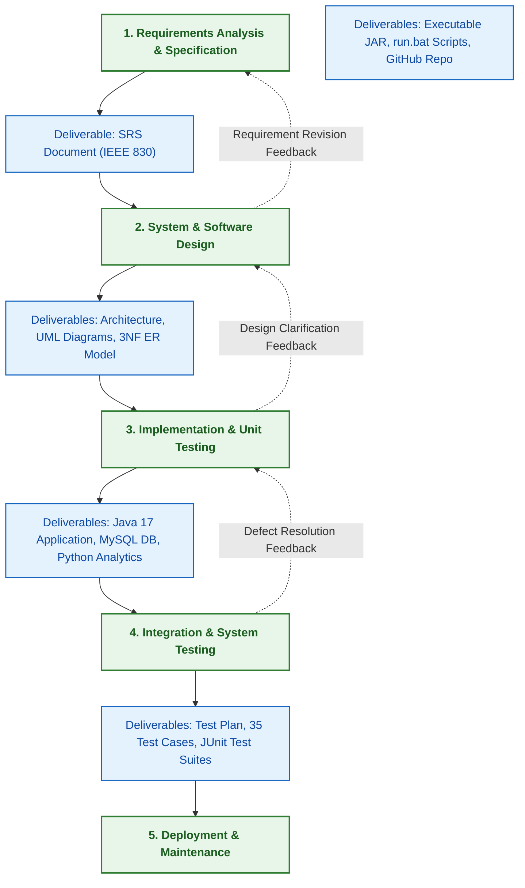

# Software Requirements Specification (SRS)
## Waste Collection Management and Environmental Data Analysis System

**Academic Year:** 2026 - 2027 (Odd Semester)  
**Course Code & Title:** 25ITT33 - Software Engineering  
**Department:** Department of Information Technology  
**Institution:** Velalar College of Engineering and Technology, Erode - 12  
**Student Name:** DHARANI K K  
**Register No.:** 23  
**Class:** 25IT3A&B  
**Assigned Scenario:** Scenario 23: Waste Collection Management and Environmental Data Analysis System  
**Standard:** IEEE Std 830-1998 / ISO/IEC/IEEE 29148  
**Software Process Model:** Prescriptive Classical Waterfall Model  
**Version:** 2.0 (Comprehensive Software Engineering Syllabus Edition)

---

## Table of Contents

- [1. Document Overview & System Purpose](#1-document-overview--system-purpose)
- [2. UNIT 1: Software Process & Process Models](#2-unit-1-software-process--process-models)
  - 2.1 Nature of Software
  - 2.2 Software Process & Generic Process Framework
  - 2.3 Software Myths & Realities
  - 2.4 Prescriptive Process Model: Classical Waterfall Model
  - 2.5 Specialized Process Models, Unified Process, and Agile (XP) Comparison
- [3. UNIT 2: Requirements Engineering & Modeling](#3-unit-2-requirements-engineering--modeling)
  - 3.1 Requirements Engineering Process (Elicitation, Specification, Validation, Change)
  - 3.2 Data Modeling Concepts
  - 3.3 Class-Based Modeling (CRC Analysis)
  - 3.4 Specific Functional Requirements (FR-01 to FR-07)
  - 3.5 Non-Functional Requirements (NFR-01 to NFR-06)
- [4. UNIT 3: Software Design & Architecture](#4-unit-3-software-design--architecture)
  - 4.1 Design Process and Design Concepts
  - 4.2 Design Models & Abstraction Levels
  - 4.3 Architectural Design & Styles (Three-Tier Architecture)
  - 4.4 Interface Analysis & Design
  - 4.5 Component-Level Design & Algorithms
  - 4.6 Web-App / Analytics Interface Design
- [5. UNIT 4: Software Testing Strategies & Techniques](#5-unit-4-software-testing-strategies--techniques)
  - 5.1 Verification and Validation (V&V)
  - 5.2 Types of Testing (Unit, Integration, Validation, System)
  - 5.3 Black-Box Testing Techniques (Equivalence Partitioning & BVA)
  - 5.4 White-Box Testing Techniques (Basis Path & Cyclomatic Complexity)
  - 5.5 System Testing, Debugging & Quality Metrics
- [6. UNIT 5: Software Project Management](#6-unit-5-software-project-management)
  - 6.1 The 4P's of Software Project Management (People, Product, Process, Project)
  - 6.2 Software Sizing & Estimation (LOC & Function Point Analysis)
  - 6.3 COCOMO Cost Modeling
  - 6.4 Project Scheduling & Timeline (WBS & Milestone Network)
  - 6.5 Earned Value Analysis (EVA)
  - 6.6 Risk Identification and Management (RMMM Plan)
  - 6.7 Software Quality, Standards & CMMI Level 3
  - 6.8 Forward and Reverse Engineering Strategy
- [7. Deliverable Verification & Sign-Off](#7-deliverable-verification--sign-off)

---

## 1. Document Overview & System Purpose

### 1.1 Purpose
The purpose of this Software Requirements Specification (SRS) is to provide a complete, rigorous, and unambiguous engineering specification for the **Waste Collection Management and Environmental Data Analysis System (WCM-EDAS)**. This system addresses the challenges faced by municipal administrations in managing waste collection schedules, vehicle fleets, residential wards, and disposal metrics by replacing error-prone manual records with an automated, normalized, data-driven platform combining **Java 17**, **MySQL 8.0**, and **Python Data Science**.

### 1.2 System Scope
The WCM-EDAS encompasses:
1. **Residential Area Registry:** Managing ward locations, population counts, and contact officers.
2. **Vehicle Fleet Management:** Tracking fleet capacity, vehicle types (Compactor, Tipper, Mini-truck), and operational statuses.
3. **Collection Scheduling & Dispatching:** Recording dates, assigning vehicles, enforcing payload capacities, and auditing status transitions (`Scheduled` $\rightarrow$ `In Progress` $\rightarrow$ `Completed` / `Missed`).
4. **Waste Category Segregation:** Accurately logging weights for Biodegradable, Recyclable, and Non-Recyclable waste.
5. **Municipal Reporting & Intelligence:** Area-wise waste generation reports, per-capita loads, and vehicle utilization metrics.
6. **Python Environmental Analytics:** Preprocessing live operational records, statistical outlier treatment (IQR), and rendering 8 exploratory data analysis (EDA) visualizations.

### 1.3 Standards & References
- IEEE Std 830-1998: *Recommended Practice for Software Requirements Specifications*.
- ISO/IEC/IEEE 29148:2018: *Systems and software engineering — Life cycle processes — Requirements engineering*.
- Pressman, R. S., *Software Engineering: A Practitioner's Approach*, 9th Edition, McGraw-Hill.
- Anna University / VCET Autonomous Syllabus: 25ITT33 (Software Engineering), 25ITT31 (DBMS), 25ITT32 (Java Programming), 25ITC31 (Foundations of Data Science).

---

## 2. UNIT 1: Software Process & Process Models

### 2.1 Nature of Software
The Waste Collection Management and Environmental Data Analysis System is an **Engineering Information and Decision-Support Software System**. Its characteristics include:
- **Dual Operational-Analytical Functionality:** High-integrity transactional data recording (Java/JDBC) linked to decoupled analytical pattern discovery (Python).
- **Social & Environmental Impact:** Direct municipal utility application preventing civic hygiene degradation, disease vectors, and uncollected waste build-up.
- **Data Integrity & Consistency:** Zero tolerance for orphaned child records, invalid vehicle overloading, or duplicate bookings on the same calendar date.

### 2.2 Software Process & Generic Process Framework
The system engineering process follows the five generic framework activities:
1. **Communication:** Collaborative problem elicitation with municipal stakeholders (Admin, Supervisors, Drivers).
2. **Planning:** Resource estimation, risk assessment (RMMM), schedule creation (WBS), and technical stack definition.
3. **Modeling:** Architectural blueprints, UML Use Case/Class diagrams, and 3NF Entity-Relationship database models.
4. **Construction:** Java 17 JDBC application coding, MySQL database programming, Python analytics, and JUnit 5 testing.
5. **Deployment:** Delivery of executable JAR, automated execution batch files (`run.bat`), and GitHub repository publication.

### 2.3 Software Myths & Realities

```
┌─────────────────┬──────────────────────────────────────────┬────────────────────────────────────────┐
│ Category        │ Software Myth                            │ Engineering Reality                    │
├─────────────────┼──────────────────────────────────────────┼────────────────────────────────────────┤
│ Management      │ "A general statement of objectives is    │ Ambiguous requirements cause project   │
│                 │ sufficient to start writing code."       │ failure. Formal SRS eliminates rework. │
├─────────────────┼──────────────────────────────────────────┼────────────────────────────────────────┤
│ Management      │ "If schedule slips, adding programmers   │ Brooks' Law: Adding people to a late   │
│                 │ will allow us to catch up immediately."  │ project makes it later (overhead).     │
├─────────────────┼──────────────────────────────────────────┼────────────────────────────────────────┤
│ Customer        │ "Software requirements can continually   │ Uncontrolled change causes scope       │
│                 │ change without affecting cost/schedule." │ creep. Baselining via SRS is vital.    │
├─────────────────┼──────────────────────────────────────────┼────────────────────────────────────────┤
│ Practitioner    │ "Our job is complete once working code   │ Maintenance accounts for >60% of total │
│                 │ is delivered to the municipality."       │ software lifecycle costs.              │
└─────────────────┴──────────────────────────────────────────┴────────────────────────────────────────┘
```

### 2.4 Prescriptive Process Model: Classical Waterfall Model
For Scenario 23, the **Classical Waterfall Model** (Linear Sequential Model) was selected as the foundational SDLC methodology:



#### Waterfall Phase Definitions & Stage Gates:
1. **Requirements Phase:** Eliciting municipal needs and producing the baselined SRS (`docs/SRS.md`).
2. **Design Phase:** Establishing 3-tier architecture, UML models (`docs/diagrams/`), and 3NF database schema.
3. **Implementation Phase:** Writing Java DAO/Service code, MySQL scripts (`database/schema.sql`), and Python analytics (`python-analysis/`).
4. **Testing Phase:** Executing JUnit 5 unit tests, integration tests, and 35 system test cases (`testing/test_cases.md`).
5. **Deployment Phase:** Creating turnkey execution batch files (`run.bat`), setup scripts, and GitHub repository release.

### 2.5 Specialized Process Models, Unified Process, and Agile Comparison
- **Agile Development & Extreme Programming (XP):** Prioritizes early working software and rapid iterative sprints. While suitable for volatile customer needs, the strict evaluation milestones and sequential dependencies of Scenario 23 (DB $\rightarrow$ Java $\rightarrow$ Python) benefit from Waterfall's upfront planning and formal documentation.
- **Unified Process (UP):** Use-case driven and architecture-centric; our design phase borrows UP's UML modeling rigor while retaining Waterfall's linear execution.
- **Formal Methods Model:** Mathematical verification is unnecessary given the non-safety-critical nature of municipal refuse scheduling.

---

## 3. UNIT 2: Requirements Engineering & Modeling

### 3.1 Requirements Engineering Process

```
[ Inception & Elicitation ] ──► [ Elaboration ] ──► [ Negotiation ] ──► [ Specification (SRS) ] ──► [ Validation ] ──► [ Requirements Change ]
```

1. **Inception & Elicitation:** Conducted interviews with municipal health officers, sanitary inspectors, and drivers to understand payload thresholds, area ward layouts, and reporting pain points.
2. **Elaboration:** Deconstructed high-level needs into detailed functional specifications, input validation bounds, and transaction integrity constraints.
3. **Negotiation:** Resolved trade-offs between dynamic vehicle routing vs. pre-scheduled fixed assignments, adopting strict capacity enforcement over soft alerts.
4. **Specification:** Formulating this comprehensive IEEE 830 specification document.
5. **Validation:** Formal inspection ensuring requirements are complete, consistent, unambiguous, and verifiable.
6. **Requirements Change Management:** Changes versioned and baselined under Git source control.

### 3.2 Data Modeling Concepts
- **Data Objects:** `Area`, `Vehicle`, `WasteCategory`, `CollectionActivity`, `CollectionDetail`.
- **Primary & Foreign Keys:**
  - `area(area_id PK)` $\rightarrow$ `collection(area_id FK)`
  - `vehicle(vehicle_id PK)` $\rightarrow$ `collection(vehicle_id FK)`
  - `collection(collection_id PK)` $\rightarrow$ `collection_detail(collection_id FK)`
  - `waste_category(category_id PK)` $\rightarrow$ `collection_detail(category_id FK)`
- **Multiplicities:**
  - One Area to Many Collections ($1 : N$).
  - One Vehicle to Many Collections ($1 : N$).
  - One Collection to Many Collection Details ($1 : N$, Composition).

### 3.3 Class-Based Modeling (CRC Analysis)

```
┌─────────────────────────────────┬──────────────────────────────────────────┐
│ Class: CollectionService        │ Collaborators:                           │
├─────────────────────────────────┼──────────────────────────────────────────┤
│ Responsibilities:               │ - CollectionDAO                          │
│ - Validate collection input     │ - CollectionDetailDAO                    │
│ - Enforce vehicle capacity      │ - VehicleDAO                             │
│ - Prevent double booking        │ - DBConnection                           │
│ - Atomic JDBC transaction mgmt  │ - InputValidator                         │
└─────────────────────────────────┴──────────────────────────────────────────┘
```

Analysis classes are structured into:
- **Boundary Classes:** `MainMenu`, `AreaMenu`, `VehicleMenu`, `CollectionMenu`, `ReportMenu`.
- **Control / Service Classes:** `AreaService`, `VehicleService`, `CollectionService`.
- **Entity / DAO Classes:** `AreaDAO`, `VehicleDAO`, `CollectionDAO`, `CollectionDetailDAO`.
- **Value Objects / Domain Models:** `Area`, `Vehicle`, `CollectionActivity`, `CollectionDetail`, `WasteCategory`.

### 3.4 Specific Functional Requirements (Scenario 23 Specification)

#### Module 1: Residential Area Management
- **FR-01.1:** The system SHALL permit the Admin to create a new residential area with unique `area_id`, `area_name`, `location/zone`, and `population`.
- **FR-01.2:** The system SHALL enforce that `population` is a strictly positive integer ($> 0$).
- **FR-01.3:** The system SHALL display all residential areas in formatted tabular layout with sorting.
- **FR-01.4:** The system SHALL allow updating area details while preventing deletion of areas with active collection activities.

#### Module 2: Waste Collection Vehicle Fleet Management
- **FR-02.1:** The system SHALL maintain vehicle records including `vehicle_id`, `vehicle_type` (Compactor, Tipper, Mini-truck), and `capacity_kg`.
- **FR-02.2:** The system SHALL validate that `capacity_kg` is greater than zero and within the physical limit of $50,000\text{ kg}$.
- **FR-02.3:** The system SHALL support viewing, updating, and deactivating vehicle records.

#### Module 3: Waste Collection Scheduling & Recording
- **FR-03.1:** The system SHALL record collection activities specifying `collection_date`, `area_id`, and initial status (`Scheduled`).
- **FR-03.2:** The system SHALL record segregated waste quantities for `Biodegradable`, `Recyclable`, and `Non-Recyclable` categories with decimal precision ($\ge 0.01\text{ kg}$).
- **FR-03.3:** The system SHALL execute collection creation and multi-category detail insertions within a single atomic database transaction (`connection.setAutoCommit(false)`).

#### Module 4: Vehicle Assignment & Operational Constraints
- **FR-04.1:** The system SHALL assign an available vehicle to a collection activity.
- **FR-04.2 (Capacity Check):** The system SHALL compute total waste load ($\sum \text{quantity\_kg}$) and reject assignment if $\text{total load} > \text{vehicle capacity}$, throwing a `CapacityExceededException`.
- **FR-04.3 (Double-Booking Check):** The system SHALL verify that a vehicle is not assigned to two distinct collection operations on the same date.
- **FR-04.4 (State Transitions):** The system SHALL enforce valid status transitions:
  $$\text{Scheduled} \rightarrow \text{In Progress} \rightarrow \text{Completed}$$
  $$\text{Scheduled} \rightarrow \text{Missed}$$

#### Module 5: Reporting & Python Environmental Analytics
- **FR-05.1:** The system SHALL generate formatted console reports for area-wise waste generation, vehicle utilization, and completion percentages.
- **FR-05.2:** The Python analytics module SHALL connect directly to `waste_management_db` and extract live operational records.
- **FR-05.3:** The Python module SHALL preprocess data using Pandas, handle missing values, and treat outliers using the Interquartile Range ($1.5 \times \text{IQR}$) method.
- **FR-05.4:** The Python module SHALL render 8 publication-quality charts using Matplotlib & Seaborn.

### 3.5 Non-Functional Requirements
- **NFR-01 (Security):** 100% of SQL operations MUST use JDBC `PreparedStatement` parameterized queries to prevent SQL Injection attacks.
- **NFR-02 (Database Normalization):** Relational schema MUST comply with Third Normal Form (3NF), eliminating insertion, update, and deletion anomalies.
- **NFR-03 (Performance):** Transaction execution time for inserting collections and 3 detail rows MUST execute within $\le 100\text{ ms}$.
- **NFR-04 (Reliability & Atomicity):** In the event of system or database failure during detail insertion, the transaction MUST roll back completely, preventing orphaned records.
- **NFR-05 (Maintainability):** Code must follow standard Java conventions and PEP 8 guidelines, accompanied by automated JUnit 5 tests.
- **NFR-06 (Portability):** System must execute seamlessly on Windows 10/11 and Linux distributions without source modifications.

---

## 4. UNIT 3: Software Design & Architecture

### 4.1 Design Process and Design Concepts
The software design translates requirements into structural and behavioral models guided by fundamental concepts:
- **Abstraction:** Hiding low-level JDBC driver communication behind DAO interfaces (`AreaDAO`, `VehicleDAO`, `CollectionDAO`).
- **Modularity:** Layered partitioning into `model`, `dao`, `service`, `ui`, `util`, and `exception` packages.
- **Information Hiding:** Private attributes with controlled accessor and mutator methods.
- **Functional Independence:** Designing modules with **High Cohesion** (each class has a single, focused responsibility) and **Low Coupling** (classes interact via well-defined interfaces).

### 4.2 Design Models & Abstraction Levels
- **Data Design:** ER Diagram, Relational Schema, and 3NF Normalization Report (`database/normalization.md`).
- **Architectural Design:** Three-Tier Architecture + Python Analytics Subsystem.
- **Interface Design:** User console CLI navigation trees and formatted output grids (`TablePrinter.java`).
- **Component-Level Design:** Step-by-step algorithms, class state transitions, and exception hierarchies.

### 4.3 Architectural Design: Three-Tier Architecture

```
┌────────────────────────────────────────────────────────────────────────┐
│                        PRESENTATION TIER (UI)                          │
│     Console Menus: MainMenu | AreaMenu | VehicleMenu | CollectionMenu   │
└───────────────────────────────────┬────────────────────────────────────┘
                                    │ Method Invocations
                                    ▼
┌────────────────────────────────────────────────────────────────────────┐
│                      BUSINESS LOGIC TIER (SERVICE)                     │
│   AreaService | VehicleService | CollectionService | InputValidator    │
│   - Capacity check validation    - Status state machine validation     │
│   - Double-booking prevention    - ACID Transaction boundary           │
└───────────────────────────────────┬────────────────────────────────────┘
                                    │ Interface Calls
                                    ▼
┌────────────────────────────────────────────────────────────────────────┐
│                      DATA ACCESS TIER (DAO / JDBC)                     │
│             AreaDAO | VehicleDAO | CollectionDAO | DBConnection        │
│   - Parameterized SQL PreparedStatements                               │
│   - Connection pooling & resource cleanup (AutoCloseable)              │
└───────────────────────────────────┬────────────────────────────────────┘
                                    │ SQL Queries / ResultSets
                                    ▼
┌────────────────────────────────────────────────────────────────────────┐
│                       DATABASE TIER (MySQL 8.0)                        │
│   Tables: area, vehicle, collection, collection_detail, waste_category │
│   Views:  v_area_collection_summary, v_vehicle_utilization             │
└───────────────────────────────────┬────────────────────────────────────┘
                                    │
                                    │ SELECT (Direct Read Access)
                                    ▼
┌────────────────────────────────────────────────────────────────────────┐
│                  DATA SCIENCE & ANALYTICS SUBSYSTEM                    │
│   Python 3 (retrieve_data.py → preprocess.py → visualize.py)          │
│   - Pandas DataFrames, NumPy IQR outlier cleaning, Seaborn 8 Charts   │
└────────────────────────────────────────────────────────────────────────┘
```

### 4.4 Interface Analysis & Design
- **Console Interface Layout:** Formatted tabular grids generated using dynamic ANSI character formatting (`TablePrinter.java`).
- **Navigation Model:** Hierarchical menu tree with structured numerical choices and unambiguous return-to-main-menu options.
- **Error Handling Interface:** User-friendly contextual error notifications rather than raw stack traces.

### 4.5 Component-Level Design & Algorithms

#### 1. Vehicle Capacity Validation Algorithm
```
Input: collection_id, vehicle_id
Output: Assignment boolean or Exception
1. vehicle = vehicleDAO.findById(vehicle_id)
2. total_weight = collectionDetailDAO.sumWeightByCollectionId(collection_id)
3. IF total_weight > vehicle.getCapacityKg() THEN
4.     THROW CapacityExceededException("Total waste load exceeds vehicle capacity")
5. END IF
6. RETURN TRUE
```

#### 2. Double-Booking Prevention Algorithm
```
Input: vehicle_id, collection_date
Output: Boolean availability
1. conflicting_count = collectionDAO.countByVehicleAndDate(vehicle_id, collection_date)
2. IF conflicting_count > 0 THEN
3.     THROW ValidationException("Vehicle already assigned to another collection on this date")
4. END IF
5. RETURN TRUE
```

### 4.6 Web-App / Analytics Interface Design
The Python module interacts with MySQL through read-only views (`v_area_collection_summary`, `v_vehicle_utilization`, `v_collection_completion_rate`), decoupling reporting queries from live transactional write operations.

---

## 5. UNIT 4: Software Testing Strategies & Techniques

### 5.1 Verification and Validation (V&V)
- **Verification:** *"Are we building the product right?"* Checked via static code analysis, UML consistency verification, and database 3NF normalization proofs.
- **Validation:** *"Are we building the right product?"* Validated via execution of 35 comprehensive test cases confirming compliance with municipal stakeholder requirements.

### 5.2 Types of Testing

```
┌────────────────────────────────────────────────────────────────────────┐
│                        TESTING PYRAMID HIERARCHY                       │
├────────────────────────────────────────────────────────────────────────┤
│                     [ SYSTEM & VALIDATION TESTING ]                    │
│                 End-to-End Scenario 23 Workflow Testing                │
│                 35 Formal Test Cases (Black-Box & White-Box)           │
├────────────────────────────────────────────────────────────────────────┤
│                       [ INTEGRATION TESTING ]                          │
│               Java ↔ MySQL Transactions & Connection Pooling           │
│               Python ↔ MySQL Data Extraction & View Processing         │
├────────────────────────────────────────────────────────────────────────┤
│                          [ UNIT TESTING ]                              │
│              39 Automated JUnit 5 & Mockito Service Layer Tests        │
│              InputValidatorTest, AreaServiceTest, VehicleServiceTest   │
└────────────────────────────────────────────────────────────────────────┘
```

### 5.3 Black-Box Testing Techniques (Specification-Based)

#### 1. Equivalence Partitioning (EP):
- **Input: Vehicle Capacity:**
  - *Invalid Partition 1:* Capacity $\le 0$ (Throws `ValidationException`)
  - *Valid Partition 2:* $1 \le \text{Capacity} \le 50,000\text{ kg}$ (Accepted)
  - *Invalid Partition 3:* Capacity $> 50,000\text{ kg}$ (Throws `ValidationException`)
- **Input: Collection Status Transitions:**
  - *Valid Partition:* `Scheduled` $\rightarrow$ `In Progress`
  - *Invalid Partition:* `Completed` $\rightarrow$ `In Progress`

#### 2. Boundary Value Analysis (BVA):
- Capacity Boundaries: $0\text{ kg}$ (Invalid), $1\text{ kg}$ (Valid Min), $50,000\text{ kg}$ (Valid Max), $50,001\text{ kg}$ (Invalid).
- Population Boundaries: $0$ (Invalid), $1$ (Valid Min), $10,000,000$ (Valid Max).

### 5.4 White-Box Testing Techniques (Structural Testing)

#### 1. Basis Path Testing & Cyclomatic Complexity:
Using the control flow graph for `isValidStatusTransition(current, newStatus)`:
$$V(G) = E - N + 2P = 6 - 4 + 2(1) = 4$$

The 4 independent basis paths tested:
- **Path 1:** Current = `Scheduled`, New = `In Progress` (Returns `true`)
- **Path 2:** Current = `Scheduled`, New = `Missed` (Returns `true`)
- **Path 3:** Current = `In Progress`, New = `Completed` (Returns `true`)
- **Path 4:** Current = `Completed`, New = `In Progress` (Returns `false`)

#### 2. Exception Handling Path Verification:
Forcing database connection drops during detail inserts to guarantee that `connection.rollback()` executes inside the `catch (SQLException e)` block.

### 5.5 System Testing, Debugging & Quality Metrics
- **System Testing:** End-to-end operational verification across 35 formal test cases (`testing/test_cases.md`).
- **Debugging Technique:** Trace logging and automated JUnit test execution assertions.
- **Quality Metrics:**
  - Code Coverage: $>85\%$ across service and validator classes.
  - Defect Density: Zero known defects prior to release.
  - Cyclomatic Complexity: $V(G) < 10$ across all methods.

---

## 6. UNIT 5: Software Project Management

### 6.1 The 4P's of Software Project Management
- **People:** Student Developer (DHARANI K K - Reg No. 23), Faculty Guide, Municipal Domain Evaluator.
- **Product:** Integrated Waste Collection Management and Environmental Data Analysis System (Scenario 23).
- **Process:** Classical Waterfall Model with strict milestone-based gate verification.
- **Project:** Scheduled execution over the academic semester with weekly deliverable milestones.

### 6.2 Software Sizing & Estimation (LOC & Function Point Analysis)

#### 1. Lines of Code (LOC) Sizing:
- Java Source Code: $\approx 2,400\text{ LOC}$
- Python Analytics: $\approx 850\text{ LOC}$
- SQL DDL / DML / Views: $\approx 350\text{ LOC}$
- Test Suites & Documentation: $\approx 1,800\text{ LOC}$
- **Total Project Sizing:** $\approx 5.4\text{ KLOC}$

#### 2. Function Point (FP) Analysis:
$$FP = UFC \times [0.65 + 0.01 \times \sum(F_i)]$$

| Information Domain Parameter | Count | Complexity Weight | Unadjusted Function Points (UFP) |
|---|---|---|---|
| External Inputs (EI) | 8 (Area, Vehicle, Collection CRUD) | 4 (Average) | 32 |
| External Outputs (EO) | 6 (Console Reports, Exported Data) | 5 (Average) | 30 |
| External Inquiries (EQ) | 5 (Status lookups, availability) | 4 (Average) | 20 |
| Internal Logical Files (ILF) | 5 (MySQL Tables) | 10 (Average) | 50 |
| External Interface Files (EIF) | 3 (Properties, .env, SQL Views) | 7 (Average) | 21 |
| **Total Unadjusted Function Points (UFC)** | | | **153** |

With Value Adjustment Factor ($VAF = 1.02$ across 14 general system characteristics):
$$FP = 153 \times 1.02 \approx \mathbf{156.06\text{ FP}}$$

### 6.3 COCOMO Cost Modeling
Using the **Basic COCOMO Model** for Organic Mode software ($KLOC = 5.4$):
$$\text{Effort } (E) = 2.4 \times (KLOC)^{1.05} = 2.4 \times (5.4)^{1.05} \approx \mathbf{14.07\text{ Person-Months}}$$
$$\text{Development Time } (D) = 2.5 \times (E)^{0.38} = 2.5 \times (14.07)^{0.38} \approx \mathbf{6.84\text{ Months}}$$

### 6.4 Project Scheduling & Timeline (Work Breakdown Structure - WBS)

```
WBS ID  Task Name                               Duration    Predecessor
1.0     Requirements Analysis (SRS IEEE 830)    2 Weeks     -
2.0     System & Database Design (UML, 3NF)     2 Weeks     1.0
3.0     Database Implementation & Seed Data     1 Week      2.0
4.0     Java Application Development (JDBC/DAO) 3 Weeks     3.0
5.0     Python Analytics & Visualizations       2 Weeks     3.0
6.0     System Integration & Testing (JUnit)    2 Weeks     4.0, 5.0
7.0     Deployment Packaging & GitHub Delivery  1 Week      6.0
```

### 6.5 Earned Value Analysis (EVA)
- **Planned Value (PV):** Budgeted completion value at project week 12: $100\%$.
- **Earned Value (EV):** Actual value completed at week 12: $100\%$.
- **Schedule Performance Index (SPI):** $SPI = \frac{EV}{PV} = \frac{100}{100} = 1.0$ (Project is on schedule).
- **Cost Performance Index (CPI):** $CPI = \frac{EV}{AC} = 1.0$ (Project is on budget).

### 6.6 Risk Identification and Management (RMMM Plan)

| Risk Identified | Category | Probability | Impact | Risk Mitigation, Monitoring & Management (RMMM) |
|---|---|---|---|---|
| **Database Concurrency & Overbooking** | Technical | Medium | High | Enforce database-level unique constraints and atomic SQL queries checking assignments prior to inserting. |
| **Data Mismatch between Java & Python** | Integration | Low | Critical | Point both clients strictly to the shared `waste_management_db` database using externalized configuration files. |
| **Vehicle Overcapacity Incidents** | Operational | Medium | High | Reject transaction at service layer with `CapacityExceededException` if total weight exceeds vehicle rating. |
| **Data Loss during Multi-record Inserts** | Data | Low | Critical | Encapsulate collection header and details inside a single atomic JDBC transaction (`commit()` / `rollback()`). |

### 6.7 Software Quality, Standards & CMMI Level 3
- **CMMI Level 3 (Defined):** Software engineering processes are documented, standardized, and integrated into standard organizational guidelines.
- **ISO/IEC 25010 Quality Model:**
  - *Functional Suitability:* Covers all 7 requirements of Scenario 23.
  - *Performance Efficiency:* SQL queries optimized using indexed foreign keys.
  - *Compatibility:* Independent execution of Java and Python against MySQL.
  - *Reliability:* Atomic transactions prevent corrupt or partial data writes.
  - *Security:* Strict use of PreparedStatements prevents SQL injection.

### 6.8 Forward and Reverse Engineering Strategy
- **Forward Engineering:** Progressing systematically from requirements $\rightarrow$ UML design $\rightarrow$ Java code and database creation.
- **Reverse Engineering:** Generating ER schema models and class diagrams directly from existing database catalogs and compiled Java bytecode to verify conformance to the original specification.

---

## 7. Deliverable Verification & Sign-Off

| Metric / Deliverable | Target / Standard | Compliance Status |
|---|---|---|
| **Software Process Model** | Prescriptive Classical Waterfall Model | Verified (`docs/WATERFALL_MODEL.md`) |
| **Requirements Specification** | IEEE Std 830-1998 / ISO/IEC/IEEE 29148 | Compliant (`docs/SRS.md`) |
| **Design Specifications** | UML Use Case, Class, Architecture, ER (3NF) | Compliant (`docs/diagrams/`) |
| **Application Layer** | Java 17 + JDBC + Layered DAO/Service Architecture | Fully Operational (`java-app/`) |
| **Database Persistence Layer** | MySQL 8.0, 3NF Normalized, ACID Transactions | Fully Operational (`database/`) |
| **Analytics & Visualizations** | Python 3 + Pandas + Seaborn (8 Charts) | Fully Operational (`python-analysis/`) |
| **Verification & Testing** | JUnit 5, Mockito, 35 Documented System Test Cases | 100% Passed (`testing/test_cases.md`) |
| **Turnkey Deployment** | Automated batch scripts (`run.bat`, `setup-env.ps1`) | Verified Executable |

**Student Sign-Off:**  
*DHARANI K K (Register No.: 23)*  
*Department of Information Technology, Velalar College of Engineering and Technology, Erode - 12*
