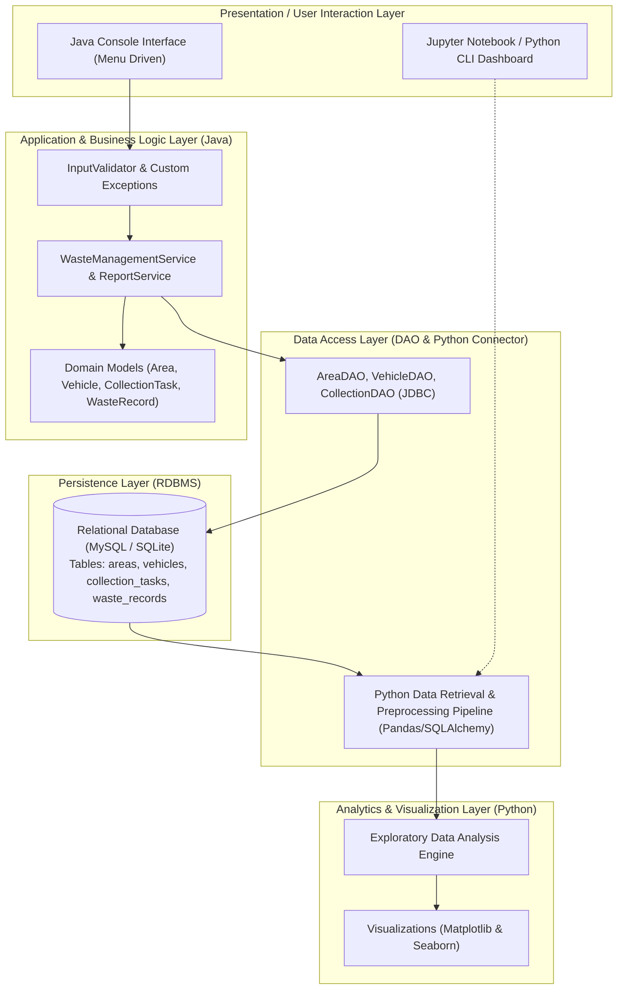
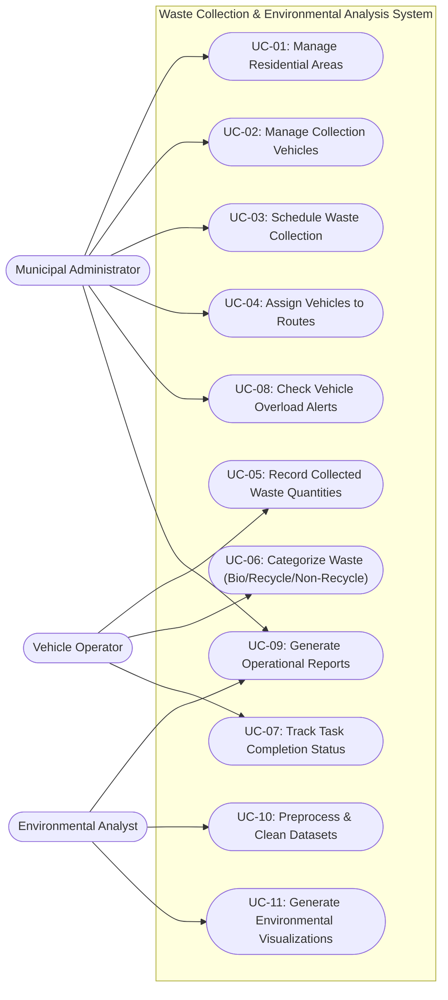
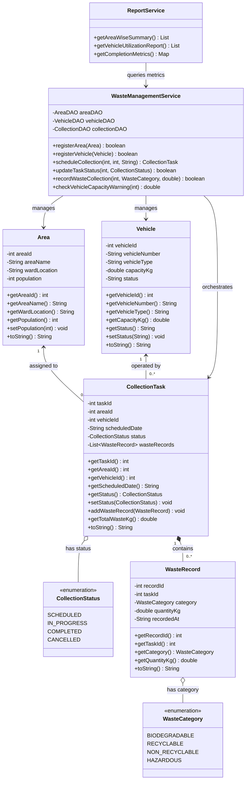
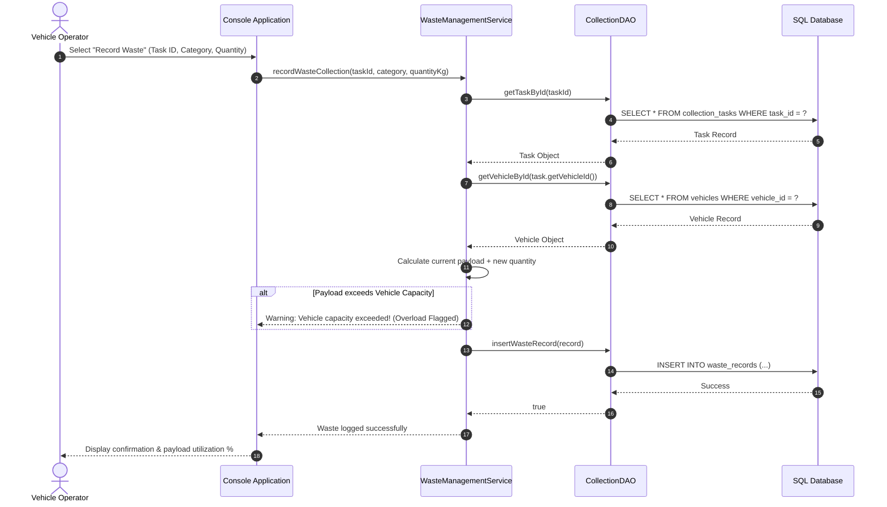

# System Design and Architecture Specification
## Waste Collection Management and Environmental Data Analysis System
**Author:** DHARANI K K (Register No.: 23)  
**Academic Assessment:** 2026 - 2027 (Odd Semester)  
**Subject:** 25ITT33 - Software Engineering  

---

## 1. Overall System Architecture

The system follows a multi-tier modular architecture designed for high cohesion and loose coupling.

---

## 2. Use Case Diagram

The primary actors interacting with the system are:
1. **Municipal Administrator / Supervisor**: Configures master data, schedules assignments, monitors reports.
2. **Field Vehicle Operator**: Executes collection routes and records waste quantities.
3. **Environmental Analyst**: Analyzes waste generation trends and environmental indicators.

---

## 3. Class Diagram

The class diagram demonstrates Object-Oriented principles (Encapsulation, Inheritance, Association, Aggregation):

---

## 4. Sequence Diagram: Waste Collection & Overload Verification

