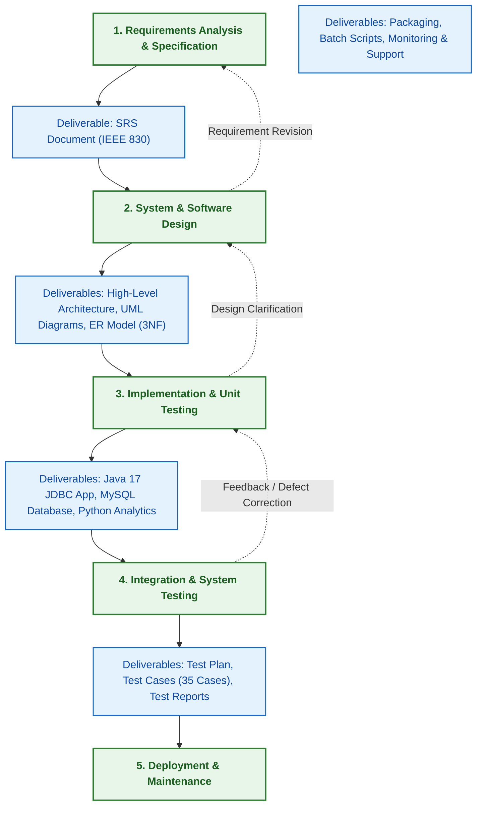

# Software Development Life Cycle (SDLC) – Waterfall Model
## Waste Collection Management and Environmental Data Analysis System

**Course:** 25ITT33 – Software Engineering (Unit 1: Software Process & Prescriptive Process Models)  
**Academic Year:** 2026–2027  
**Department:** Department of Information Technology  
**Institution:** Velalar College of Engineering and Technology, Erode - 12  
**Student Name:** DHARANI K K  
**Register No.:** 23  
**Class:** 25IT3A&B  
**Assigned Scenario:** Scenario 23  
**Standard:** IEEE Std 1074 / IEEE Std 830 / ISO/IEC 12207  

---

## 1. Overview and Model Selection Rationale

The **Classical Waterfall Model** (Linear Sequential Life Cycle Model) is a prescriptive process model where software engineering proceeds through distinct, ordered phases. Each phase requires completion and verification before the next phase commences, providing clear milestones and verifiable deliverables at each stage gate.

### Why the Waterfall Model Fits Scenario 23

1. **Clear and Stable Requirements:** Municipal requirements for residential areas, vehicle capacities, waste categorization (Biodegradable, Recyclable, Non-Recyclable), and environmental analytics are clearly specified in the project brief.
2. **Sequential Technical Dependencies:** 
   - The **Database Schema (MySQL 3NF)** must be defined and created before developing Java Data Access Objects (DAOs).
   - The **Java Application** must be implemented to write operational records before the **Python Analytics Module** can retrieve data and generate visualizations.
3. **Rigorous Quality Gateways:** Each phase generates a concrete, evaluable deliverable (SRS $\rightarrow$ UML & ER Design $\rightarrow$ Source Code $\rightarrow$ Test Cases $\rightarrow$ GitHub Repository).
4. **End-to-End Traceability:** Every test case traces directly back to the functional requirements (`FR-01` to `FR-07`).

---

## 2. Phase-by-Phase Mapping

### Phase 1: Requirements Analysis and Specification
* **Objective:** Understand municipal waste collection operations and define formal system requirements.
* **Input:** Scenario 23 Problem Statement (Velalar College of Engineering and Technology IT Department Assessment).
* **Key Activities:**
  - Requirements elicitation for municipal stakeholders (Admin, Supervisor, Driver/Operator).
  - Feasibility analysis: Technical (Java 17, MySQL 8.0, Python 3.9+), Economic, and Operational.
  - Requirement definition into Functional Requirements (`FR-01` to `FR-07`) and Non-Functional Requirements (`NFR-01` to `NFR-06`).
* **Deliverable:** `docs/SRS.md` (IEEE Std 830-1998 compliant).
* **Phase Gate:** Baselined SRS sign-off.

---

### Phase 2: System and Software Design
* **Objective:** Translate requirements into architectural, procedural, and data models.
* **Input:** Baselined SRS (`docs/SRS.md`).
* **Key Activities:**
  - **Architectural Design:** Three-tier architecture (Presentation $\rightarrow$ Business Logic $\rightarrow$ Data Access) + Decoupled Python Analytics.
  - **Database Design:** Entity-Relationship (ER) model normalized to Third Normal Form (3NF) to eliminate insertion, update, and deletion anomalies.
  - **Object-Oriented Design:** UML Use Case diagrams for user interactions and Class diagrams for domain models, DAOs, and services.
* **Deliverables:**
  - Architecture Diagram (`docs/diagrams/architecture.puml`)
  - Use Case Diagram (`docs/diagrams/use_case.puml`)
  - Class Diagram (`docs/diagrams/class_diagram.puml`)
  - ER Diagram & Relational Model (`docs/diagrams/er_diagram.puml`, `database/relational_model.md`, `database/normalization.md`)
* **Phase Gate:** Design Review approving class and database schemas.

---

### Phase 3: Implementation and Unit Testing
* **Objective:** Code and compile all software modules.
* **Input:** Approved design models and database schemas.
* **Key Activities:**
  - **Database Implementation:** MySQL database `waste_management_db`, tables with constraints, SQL views, and seed data (`database/schema.sql`, `database/seed_data.sql`).
  - **Java Application:** Java 17 layered architecture with JDBC `PreparedStatement` to prevent SQL injection, ACID transactions (`setAutoCommit(false)`), and interactive console menus.
  - **Python Data Analytics:** Database connector (`retrieve_data.py`), data cleaning/preprocessing (`preprocess.py`), and 8 EDA charts using Pandas, Matplotlib, and Seaborn (`visualize.py`, `analysis.ipynb`).
* **Deliverables:**
  - Java source code (`java-app/src/main/java/com/waste/`)
  - Database scripts (`database/schema.sql`, `database/seed_data.sql`)
  - Python analytics scripts (`python-analysis/`)
* **Phase Gate:** Clean Maven build (`mvn compile`) and successful database initialization.

---

### Phase 4: Integration and System Testing
* **Objective:** Validate that all integrated components satisfy requirements.
* **Input:** Compiled Java code, initialized MySQL database, Python analytics scripts, test plan.
* **Key Activities:**
  - **Unit Testing:** Isolated service-layer testing using JUnit 5 and Mockito mocks (39 unit tests).
  - **Integration Testing:** Verification of Java JDBC writes and Python `mysql-connector` reads from the shared database.
  - **System Testing:** Black-box (Equivalence Partitioning, Boundary Value Analysis) and white-box test cases covering 35 documented scenarios.
* **Deliverables:**
  - Test Plan (`testing/test_plan.md`)
  - Test Cases & Execution Results (`testing/test_cases.md`)
* **Phase Gate:** 100% test execution pass rate.

---

### Phase 5: Deployment and Maintenance
* **Objective:** Deploy the system into the municipal operational environment and document operations.
* **Input:** Tested JAR artifacts, SQL schemas, Python scripts, configuration templates.
* **Key Activities:**
  - Packaging the application into an executable JAR (`mvn package`).
  - Providing automated startup scripts (`run.bat`, `setup-env.ps1`).
  - Authoring user documentation in `README.md`.
  - Establishing maintenance protocols:
    * **Corrective:** Bug fixes and SQL constraint corrections.
    * **Adaptive:** Updating dependencies (e.g. newer pandas/seaborn versions).
    * **Perfective:** Adding GPS tracking and web interfaces.
* **Deliverables:**
  - Executable JAR artifact (`java-app/target/waste-management.jar`)
  - Turnkey launch scripts (`run.bat`)
  - Project documentation (`README.md`)
* **Phase Gate:** Project repository finalized on GitHub.

---

## 3. Academic Syllabus Integration

| Course Code & Name | Syllabus Unit | Project Artifact / Waterfall Phase |
|---|---|---|
| **25ITT33: Software Engineering** | Unit 1: Software Process & Prescriptive Models Unit 2: Requirements Analysis & Specification Unit 3: Software Design & Architecture Unit 4: Verification, Validation & Testing | `docs/WATERFALL_MODEL.md` `docs/SRS.md` (IEEE 830 standard) `docs/diagrams/*.puml` (Use Case, Class, Architecture) `testing/test_cases.md` (Black Box / White Box) |
| **25ITT31: DBMS** | Unit 1: ER Design Unit 2: SQL & Views Unit 3: Normalization (3NF) Unit 4: Transaction Management | `docs/diagrams/er_diagram.puml` `database/schema.sql`, `database/queries.sql` `database/normalization.md` Java `setAutoCommit(false)` atomic transactions |
| **25ITT32: Java Programming** | Unit 1: Java Fundamentals & I/O Unit 2: OOP & Interfaces Unit 3: Custom Exception Handling Unit 4: JDBC & PreparedStatements Unit 5: Collections Framework | Console UI menus Layered Service & DAO interfaces `ValidationException`, `CapacityExceededException` `DBConnection.java`, JDBC PreparedStatements `List<CollectionActivity>`, `Map<Integer, WasteCategory>` |
| **25ITC31: Data Science** | Unit 2: Python Foundations Unit 3: Data Wrangling (Pandas/NumPy) Unit 4: Cleaning & Outlier Treatment Unit 5: EDA & Visualizations | `python-analysis/retrieve_data.py` `python-analysis/preprocess.py` IQR outlier detection & missing value treatment `python-analysis/visualize.py` (8 analytical charts) |
